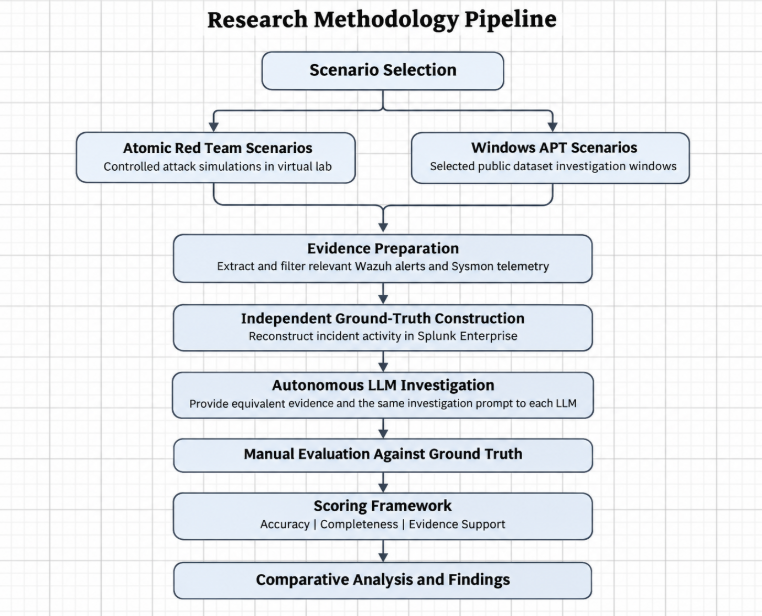

# Research Design

## Research Approach

This project uses an experimental comparative evaluation approach to examine how selected Large Language Models (LLMs) autonomously investigate security incidents using Wazuh alerts and Sysmon telemetry. Investigation reports are compared against an independently established ground truth using three evaluation dimensions: accuracy, completeness and evidence support.

## Experimental Design

Each selected LLM investigates the same security scenarios under controlled conditions. Every model receives the same evidence, investigation instructions, prompt structure and required report format. The outputs are then manually compared against independently established ground truth using a consistent scoring framework.

## Controlled Variables

To ensure a fair comparison, the attack scenario, evidence, prompt, investigation instructions, report structure, ground truth and scoring framework remain consistent across the models. No additional human guidance, correction or follow-up instructions are provided once an investigation begins.

## Attack Scenario Selection

Attack scenarios include controlled Atomic Red Team tests and more complex investigation windows selected from the publicly available Windows APT dataset.

Scenarios are selected based on the availability of suitable security evidence, the ability to establish reliable ground truth, relevance to security incident investigation and differences in activity complexity.

Including scenarios of varying complexity allows the research to examine whether LLM performance changes when investigating more complex security activity.

## LLM Selection

The project evaluates selected general-purpose LLMs. Models are selected based on their capabilities, accessibility, reasoning functionality and ability to process the required security evidence.

The model name, version, subscription tier and relevant settings used during each investigation are recorded to support transparency and reproducibility.

## Methodology Pipeline

The research follows a structured investigation and evaluation pipeline, shown in the accompanying methodology flowchart.

1. **Scenario Selection** - Select controlled Atomic Red Team tests and Windows APT investigation scenarios.
2. **Evidence Preparation** - Collect or extract relevant Wazuh alerts and Sysmon telemetry, applying consistent filtering and formatting procedures.
3. **Ground-Truth Construction** - Use Splunk Enterprise to analyse security evidence and independently establish the expected incident findings.
4. **Autonomous LLM Investigation** - Provide each LLM with equivalent evidence and identical investigation instructions.
5. **Manual Evaluation** - Compare the generated investigation reports against the established ground truth.
6. **Scoring** - Evaluate accuracy, completeness and evidence support using the defined scoring framework.
7. **Comparative Analysis** - Compare model performance across the selected scenarios and identify limitations, errors and differences in investigation quality.

## Reliability and Reproducibility

A consistent procedure is applied across all models and scenarios. Investigations are conducted in separate clean sessions, with the evidence, prompts, ground truth, model details and investigation outputs documented.

This supports reproducibility and allows the evaluation process to be reviewed. However, LLM outputs may vary between repeated investigations, even when identical evidence and instructions are provided.